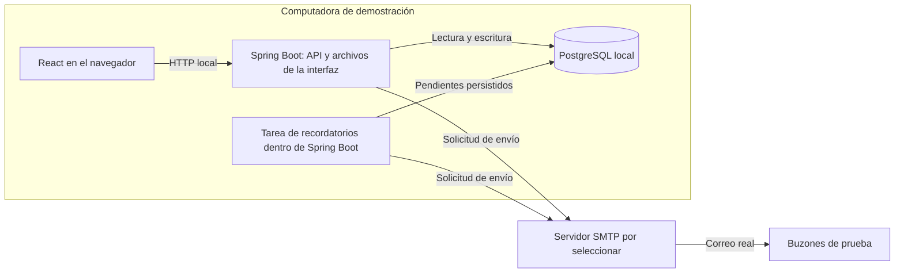

# Descripción general

**Estado del documento**: aprobado por el usuario el 2026-11-18.
**Confirmación**: «continuemos», en respuesta a la revisión del documento 02 y propuesta de continuar con el 03.
**Fecha**: 2026-11-18.
**Base**: [Visión y objetivos aprobados](01_vision_y_objetivos.md), [Discovery aprobado](../discovery/discovery.md) y [stack aprobado](../discovery/propuesta-tecnica-kb.md).

El stack, el alcance local, la organización de componentes y el enfoque de empaquetado fueron aprobados. El mapa de API se aprobó como orientación de responsabilidades; las rutas y contratos detallados se concretarán al especificar las funcionalidades. Los pendientes identificados permanecen abiertos. No hay aplicación implementada ni dependencias instaladas.

## Tipo de sistema y alcance operativo

Aplicación web con interfaz de paciente y acceso interno del odontólogo. La primera versión atiende a **un único consultorio, un odontólogo y una agenda**, con ejecución local y emails reales a destinatarios de prueba. El propósito comercial futuro es ofrecer un SaaS a consultorios; el aislamiento y operación de múltiples organizaciones se diseñarán en una etapa posterior.

El paciente no crea una cuenta ni verifica previamente el email. Consulta disponibilidad, reserva y recibe enlaces privados de autogestión. El odontólogo configura los motivos y sus duraciones, el horario semanal, las pausas y los bloqueos, y consulta su agenda y los datos básicos de pacientes. El mecanismo concreto de acceso interno y la validación de enlaces siguen pendientes de diseño.

## Stack tecnológico

| Capa o función | Tecnología aprobada | Versión o condición pendiente |
|---|---|---|
| Lenguaje del backend | Java, distribución Eclipse Temurin | Java 21 aprobado; actualización de mantenimiento exacta por fijar. |
| Backend | Spring Boot | Versión estable compatible por fijar; sin adoptar versiones preliminares de documentación. |
| Construcción del backend | Gradle mediante Gradle Wrapper | Versión compatible con Spring Boot y Java 21 por fijar. |
| Interfaz web | React y TypeScript, con CSS | Versiones exactas de React y TypeScript por fijar. |
| Desarrollo y compilación web | Vite, Node.js y npm | Versiones compatibles por fijar; Node.js es una herramienta de desarrollo y compilación en la propuesta de empaquetado. |
| Persistencia | PostgreSQL local | Versión estable soportada por fijar. |
| Envío de correo | Spring Mail y SMTP | Biblioteca compatible con Spring Boot; cuenta, proveedor y remitente pendientes. |
| Recordatorios | Tarea programada dentro del backend y estado de notificaciones persistido | Frecuencia de ejecución, reintentos y recuperación tras interrupciones pendientes. |

No se seleccionan todavía ORM, herramienta de migraciones, biblioteca de componentes visuales ni librería de calendario. Sus necesidades y alternativas se evaluarán al detallar los documentos correspondientes. No hay un mínimo de versión aprobado para las herramientas pendientes: se deberán fijar versiones concretas compatibles antes de generar el proyecto.

## Arquitectura general

Se acordó una aplicación Spring Boot que concentre API, reglas de turnos, acceso a PostgreSQL, envío de email y tareas de recordatorios. La organización por funciones permite mantener juntas las responsabilidades de cada área sin agregar procesos de backend independientes.

La tarea del diagrama forma parte del proceso Spring Boot; no representa otro servicio que haya que desplegar. La base de datos sí es un proceso local independiente. El servidor SMTP pertenece al proveedor de correo, todavía no elegido.

### Responsabilidades de los componentes

| Componente lógico | Responsabilidad | Condición relevante |
|---|---|---|
| Interfaz web | Mostrar motivos, horarios disponibles, formulario de reserva, autogestión y agenda del odontólogo. | La comprobación definitiva de disponibilidad y plazos corresponde al backend. El diseño visual se definirá en la fase de diseño. |
| Agenda y disponibilidad | Aplicar motivos y duraciones, horario semanal, pausas, bloqueos y ocupación existente. | Debe preservar las reglas de 24 horas y 30 días y prevenir solapamientos, también ante concurrencia. |
| Turnos y datos básicos | Registrar y consultar los turnos y sus datos asociados: nombre, apellido, email, teléfono y DNI. | Identificación, duplicados y correcciones pendientes de definición; no se agrega una ficha clínica. |
| Comunicaciones | Preparar confirmaciones, cambios y recordatorios; conservar estado de envío y comunicarse con SMTP. | Disponibilidad y entrega del correo no se deducen de la persistencia del turno. La política ante fallas se detallará en los flujos. |
| Persistencia | Conservar configuración, pacientes, turnos y estado de notificaciones entre reinicios. | Transacciones, restricciones y mecanismo concreto de concurrencia por diseñar en modelo de datos y arquitectura. |

La consulta de un horario libre no constituye una reserva. El backend deberá volver a comprobar las condiciones al registrar la operación y garantizar el criterio CA-VIS-03 del documento 01. Reprogramación, generación de notificaciones y recuperación de errores se detallarán sin asumir que una transacción de base de datos vuelve transaccional un envío SMTP.

## Ejecución local acordada

Para la demostración se acordó compilar la interfaz con Vite y servir los archivos resultantes desde Spring Boot, junto a la API. Esto concentra la navegación y las solicitudes de API en un mismo origen local y permite ejecutar la demostración sin un servidor de Node.js separado. Vite genera archivos estáticos y Spring Boot puede servirlos; la integración de la compilación y la resolución de rutas de navegación deben implementarse y probarse expresamente. [Vite: compilación](https://vite.dev/guide/build.html), [Spring Boot: contenido estático](https://docs.spring.io/spring-boot/reference/web/servlet.html#web.servlet.spring-mvc.static-content).

Durante el desarrollo se acordó mantener Vite y Spring Boot como procesos separados para trabajar sobre la interfaz, con solicitudes de API reenviadas al backend por el proxy de desarrollo de Vite. Ese proxy solo corresponde al entorno de desarrollo; no define un despliegue público. Puertos, URL base y configuración exacta se fijarán al preparar el proyecto. [Vite: proxy de desarrollo](https://vite.dev/config/server-options.html#server-proxy).

En ambos casos, PostgreSQL conservará los datos localmente. El backend necesita permanecer ejecutándose y contar con conectividad para enviar emails a tiempo. La dirección incluida en los enlaces debe coincidir con la URL local acordada; el enlace `localhost` se comprobará en la misma computadora que ejecuta la aplicación.

## Integraciones externas

| Servicio | Propósito | Tipo | Estado y dependencia |
|---|---|---|---|
| Proveedor de correo por seleccionar | Confirmación inmediata, aviso de cambios, recordatorio 24 horas antes y enlaces privados de gestión. | SMTP mediante Spring Mail. | Integración funcional aprobada; cuenta, credenciales, remitente, cuotas y condiciones gratuitas pendientes. |

Spring Boot ofrece soporte para `JavaMailSender` y su configuración SMTP. Esto permite implementar el conector, pero no crea una cuenta de correo ni garantiza entrega. El envío necesita tiempos de espera finitos y una política de fallas que se definirá en arquitectura y flujos. [Spring Boot: envío de email](https://docs.spring.io/spring-boot/reference/io/email.html).

La recepción efectiva de los mensajes se comprobará con destinatarios de prueba, conforme a CA-VIS-06. El proveedor aceptando una solicitud SMTP y el destinatario recibiendo el correo son hechos diferentes. Ninguna prueba se considera ejecutada en esta fase documental.

WhatsApp, calendarios externos, servicios de pago, facturación y radiología no forman parte de las integraciones de esta entrega. PostgreSQL local es un componente de persistencia, no un servicio externo contratado.

## API REST propuesta

Se acordó comunicación HTTP con datos JSON entre la interfaz y el backend. Las siguientes rutas son un mapa inicial de responsabilidades aprobado como orientación, no un contrato OpenAPI ni endpoints implementados. Los nombres, esquemas de entrada y salida y respuestas de error se concretarán al especificar cada funcionalidad.

| Acceso previsto | Método y ruta propuestos | Propósito |
|---|---|---|
| Paciente, sin cuenta | `GET /api/public/motivos` | Consultar motivos ofrecidos para reservar. |
| Paciente, sin cuenta | `GET /api/public/disponibilidad` | Consultar horarios libres según motivo y período permitido. |
| Paciente, sin cuenta | `POST /api/public/turnos` | Solicitar reserva con los cinco datos obligatorios; confirmar al obtener un horario válido y libre. |
| Paciente, mediante credencial del enlace privado | `GET /api/gestion/turno` | Consultar la información necesaria para gestionar su propio turno. |
| Paciente, mediante credencial del enlace privado | `POST /api/gestion/turno/cancelacion` | Cancelar el propio turno dentro del plazo permitido. |
| Paciente, mediante credencial del enlace privado | `POST /api/gestion/turno/reprogramacion` | Solicitar un nuevo horario válido y libre dentro del plazo permitido. |
| Odontólogo, acceso interno | `GET /api/odontologo/agenda` | Consultar la agenda diaria o semanal. |
| Odontólogo, acceso interno | `GET /api/odontologo/turnos/{id}` | Consultar los datos básicos asociados a un turno de su agenda. |
| Odontólogo, acceso interno | `GET, POST, PUT /api/odontologo/motivos` | Consultar y configurar motivos y duraciones; detalle de identificadores por especificar. |
| Odontólogo, acceso interno | `GET, PUT /api/odontologo/horario` | Consultar y configurar el horario semanal y las pausas. |
| Odontólogo, acceso interno | `GET, POST, DELETE /api/odontologo/bloqueos` | Consultar y gestionar bloqueos; detalle de identificadores y efectos sobre turnos existentes por especificar. |

Las rutas públicas de disponibilidad no deben publicar la lista de pacientes ni sus datos. La autogestión se limita al turno autorizado por el enlace privado; no se propone búsqueda pública por DNI o por identificador de turno. El mecanismo de credencial, su transporte, vencimiento y validación siguen pendientes del análisis de acceso de los documentos 03 y 08. No se elige JWT ni un proveedor de identidad por inferencia.

La reserva, cancelación y reprogramación producen cambios mediante operaciones de escritura; abrir o previsualizar un enlace por sí solo no debe ejecutar esos cambios. La interacción y su manejo de errores se detallarán en los flujos, antes de implementar.

## Pendientes para completar esta descripción

| Pendiente | Dónde se desarrollará | Impacto |
|---|---|---|
| Versiones exactas y compatibilidad de herramientas. | Preparación del proyecto y documento 08. | Bloquea generar una configuración reproducible. |
| Acceso del odontólogo y credenciales de autogestión. | Documentos 03, 07 y 08. | Bloquea implementar el acceso a datos y cambios protegidos. |
| Modelo, restricciones y concurrencia. | Documentos 04, 05 y 08. | Bloquea concretar reservas y reprogramaciones sin solapamientos. |
| Zona horaria, límites temporales, reserva a 24 horas y cambios con turnos existentes. | Documentos 05 y 07. | Bloquea cerrar los casos límite de aceptación. |
| Identificación, duplicados y corrección de datos de pacientes. | Documentos 04 y 05. | Bloquea definir actualización y reutilización de datos. |
| Proveedor SMTP y fallas, reintentos, duplicados y recuperación de avisos. | Documentos 07 y 08. | Bloquea verificar el comportamiento completo de email y recordatorios. |

Las referencias a otros documentos se desarrollaron al completar la estructura y sus estados figuran en el [índice](README.md). La redacción de esas propuestas no marca los pendientes como resueltos ni habilita código de dominios CRITICAL sin la aprobación que exige la gobernanza del proyecto.

## Fuentes técnicas y fecha de consulta

Consultadas el **2026-11-18**, mediante Context7 y documentación oficial. Se utilizaron para comprobar capacidades técnicas; no se tomaron las versiones de las ramas `main` como versiones seleccionadas.

| Fuente | URL | Alcance de la evidencia |
|---|---|---|
| Spring Boot — Servlet Web Applications | https://docs.spring.io/spring-boot/reference/web/servlet.html | API mediante Spring MVC y servicio de contenido estático. La elección de integración local es una decisión del proyecto. |
| Vite — Building for Production | https://vite.dev/guide/build.html | Compilación a archivos aptos para servir estáticamente. |
| Vite — Server Options | https://vite.dev/config/server-options.html#server-proxy | Proxy de solicitudes en el servidor de desarrollo. |
| Spring Boot — Sending Email | https://docs.spring.io/spring-boot/reference/io/email.html | Conector de email, configuración SMTP y tiempos de espera. Evidencia consultada durante la propuesta técnica aprobada. |
| Spring Framework — Task Execution and Scheduling | https://docs.spring.io/spring-framework/reference/integration/scheduling.html | Soporte de tareas programadas. Evidencia consultada durante la propuesta técnica aprobada. |

La justificación y las fuentes de la selección de Java, PostgreSQL y el resto del stack se conservan en el [documento técnico aprobado](../discovery/propuesta-tecnica-kb.md). Este documento no acredita instalación, compilación, prueba de concurrencia ni entrega de correos.
