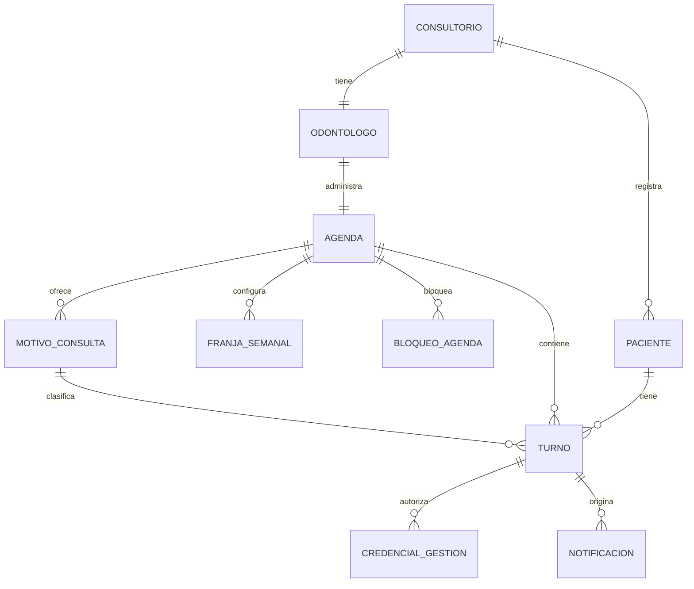

# Modelo de datos

**Estado del documento**: aprobado por el usuario el 2026-11-18.
**Confirmación**: «Aprobar el documento 04 y continuar con el 05».
**Fecha**: 2026-11-18.
**Base**: [Visión y objetivos](01_vision_y_objetivos.md), [descripción general](02_descripcion_general.md) y [actores y roles](03_actores_y_roles.md), aprobados.

El usuario aprobó este modelo lógico para la primera versión local. Los nombres, atributos, tipos y restricciones constituyen la base acordada; los índices se conservan como candidatos de diseño físico. No existen tablas creadas, migraciones ni código de acceso. Las políticas identificadas como pendientes deberán resolverse antes de implementar el flujo afectado.

## Dominios

| Dominio | Responsabilidad |
|---|---|
| Consultorio y profesional | Identificar el único consultorio, su odontólogo y su agenda. |
| Configuración de disponibilidad | Motivos y duraciones, horario semanal, pausas y bloqueos de fechas concretas. |
| Pacientes y turnos | Guardar los datos básicos y las reservas confirmadas o canceladas. |
| Autogestión | Vincular una credencial privada con el turno que permite gestionar. |
| Comunicaciones | Persistir las notificaciones previstas y su estado de envío. |

La presencia de identificadores de consultorio no incorpora operación multiempresa. Esta entrega tendrá un solo consultorio, un odontólogo y una agenda. El perfil de odontólogo representa al actor de negocio; las credenciales de ingreso interno no se modelan todavía.

## ERD (Entity Relationship Diagram)

Las relaciones muestran la configuración funcional prevista. Durante la instalación pueden no existir registros; la inicialización deberá completar la configuración única antes de ofrecer reservas.

Cada turno pertenece a una agenda, un registro de paciente y un motivo. Una credencial o notificación pertenece a un solo turno. La cardinalidad permite conservar credenciales invalidadas y varios avisos; el número de enlaces activos y su ciclo de vida siguen pendientes. Las entidades lógicas no obligan a crear un servicio separado por entidad.

## Tipos y convenciones

| Concepto | Representación acordada | Consideración |
|---|---|---|
| Identificador interno | UUID | Claves técnicas; conocer un identificador no concede acceso. |
| Nombre, apellido, email, teléfono y DNI | Texto | DNI y teléfono no son cantidades para calcular. Formatos, normalización y longitudes máximas pendientes. |
| Duración | Entero positivo en minutos | Configurable por motivo; mínimo, máximo y múltiplos permitidos por definir. |
| Instante concreto | `timestamp with time zone` en PostgreSQL | Reserva, bloqueo y envío se comparan como instantes. La zona del consultorio se conserva aparte. |
| Horario semanal | Día de semana y horas locales | Se convierte a fechas concretas usando la zona acordada del consultorio. |
| Campos de estado | Valores acotados | Turno, notificación y validez de enlace son conceptos diferentes. |

PostgreSQL conserva los valores `timestamp with time zone` como instantes normalizados y no conserva el nombre de zona que se ingresó. Por eso se acordó guardar un identificador de zona horaria en la configuración del consultorio; su valor no se infiere de la computadora del desarrollador. [Documentación oficial de fechas y horas](https://www.postgresql.org/docs/current/datatype-datetime.html), consultada el 2026-11-18 mediante Context7.

## Entidades

En todas las entidades se acordó una clave primaria `id: UUID` no nula. Las referencias serán claves foráneas. Los índices siguientes son candidatos de diseño, sin DDL ni selección de ORM o herramienta de migraciones.

### Consultorio

- **Atributos**: `id`; `nombre_visible: texto` para identificar la demostración; `zona_horaria: texto` con identificador de zona, valor pendiente.
- **Relaciones**: un odontólogo y varios registros de paciente; la agenda se obtiene a través del odontólogo.
- **Restricciones**: una sola configuración de consultorio en esta entrega; impedir configuraciones adicionales mediante el mecanismo que se concrete al implementar. El nombre de demostración no decide la marca comercial.
- **Índices**: clave primaria. No se requieren búsquedas entre organizaciones.

### Odontologo

- **Atributos**: `id`; `consultorio_id: UUID`; `nombre_visible: texto` de demostración.
- **Relaciones**: pertenece a un consultorio y administra una agenda.
- **Restricciones**: `consultorio_id` obligatorio y único, para un profesional por consultorio. La existencia del perfil no constituye autenticación.
- **Índices**: clave primaria y unicidad de `consultorio_id`.

No se agregan matrícula, especialidades, firma, liquidaciones ni datos clínicos como requisitos de este perfil mínimo. El vínculo con la identidad de acceso se decidirá en arquitectura.

### Agenda

- **Atributos**: `id`; `odontologo_id: UUID`.
- **Relaciones**: pertenece a un odontólogo; contiene motivos, franjas semanales, bloqueos y turnos.
- **Restricciones**: `odontologo_id` obligatorio y único. No se duplica `consultorio_id` en agenda: se deriva del odontólogo para evitar referencias contradictorias.
- **Índices**: clave primaria y unicidad de `odontologo_id`.

### MotivoConsulta

- **Atributos**: `id`; `agenda_id: UUID`; `nombre: texto`; `duracion_minutos: entero`.
- **Relaciones**: pertenece a una agenda; clasifica cero o más turnos.
- **Restricciones**: nombre no vacío y duración positiva. Motivo y turno deben pertenecer a la misma agenda. Desactivación, eliminación y cambios con reservas existentes siguen pendientes; no se presume borrado en cascada.
- **Índices**: clave primaria y búsqueda por `agenda_id`.

### FranjaSemanal

- **Atributos**: `id`; `agenda_id: UUID`; `dia_semana: entero` con convención acordada lunes 1 a domingo 7; `hora_inicio: hora local`; `hora_fin: hora local`; `tipo: ATENCION | PAUSA`.
- **Relaciones**: pertenece a una agenda.
- **Restricciones**: día válido, inicio anterior al fin y tipo explícito. La disponibilidad se obtiene de las franjas de atención descontando pausas, bloqueos y turnos. Las franjas que crucen medianoche, se repitan o se superpongan requieren una política pendiente.
- **Índices**: consulta por `agenda_id`, `dia_semana` y hora de inicio.

Se acordó representar atención y pausas en una entidad para simplificar el modelo. No se define todavía si las pausas deben estar completamente contenidas en una franja de atención ni su validación exacta.

### BloqueoAgenda

- **Atributos**: `id`; `agenda_id: UUID`; `inicio: instante`; `fin: instante`; `descripcion: texto opcional`.
- **Relaciones**: pertenece a una agenda.
- **Restricciones**: inicio anterior al fin. Un bloqueo retira disponibilidad durante un intervalo concreto, por vacaciones u otra excepción; no cancela turnos por sí solo. Política de intersección con reservas existentes pendiente.
- **Índices**: búsqueda por agenda e intervalo; estrategia concreta de índice temporal pendiente.

### Paciente

- **Atributos**: `id`; `consultorio_id: UUID`; `nombre: texto`; `apellido: texto`; `email: texto`; `telefono: texto`; `dni: texto`.
- **Relaciones**: pertenece al consultorio; puede asociarse a varios turnos.
- **Restricciones**: los cinco datos básicos son obligatorios para reservar. La forma exacta de validarlos sigue pendiente. El paciente y la agenda del turno deben corresponder al consultorio de esta entrega.
- **Índices**: clave primaria y consulta por `consultorio_id`. Índices de búsqueda por DNI o email solo si la política de identificación los requiere.

No se propone todavía una restricción de unicidad por DNI, email o teléfono, ni una combinación para identificar automáticamente a una persona. Se debe decidir si una nueva reserva crea un registro o reutiliza uno existente. Una coincidencia de datos no autoriza sobrescribir, fusionar ni mostrar información previa. Estos campos no son credenciales de acceso.

### Turno

- **Atributos**: `id`; `agenda_id: UUID`; `paciente_id: UUID`; `motivo_id: UUID`; `inicio: instante`; `fin: instante`; `duracion_reservada_minutos: entero`; `estado: CONFIRMADO | CANCELADO`; `revision: entero`; `creado_en: instante`; `cancelado_en: instante opcional`.
- **Relaciones**: una agenda, un paciente y un motivo; cero o más credenciales y notificaciones.
- **Restricciones**: referencias obligatorias; inicio anterior al fin; duración positiva y coherente con el intervalo guardado. `cancelado_en` debe ser coherente con el estado. Un turno confirmado ocupa su intervalo; uno cancelado deja de ocuparlo.
- **Índices**: consulta de agenda por `agenda_id` e `inicio`; consulta por paciente si los flujos internos la requieren; control de solapamiento por agenda, intervalo y estado a concretar.

Se acordó guardar la duración al reservar para que un cambio posterior del motivo no reescriba silenciosamente el intervalo existente. La política de cambiar motivos o duraciones con turnos ya reservados sigue pendiente.

Se acordó conservar el identificador de turno al reprogramar y actualizar su intervalo y revisión. La revisión permite reconocer avisos preparados para una versión anterior del turno; por sí sola no resuelve concurrencia ni constituye historial de cambios. El uso para control transaccional se diseñará después. No se agrega un estado `REPROGRAMADO`, ya que el turno vigente sigue confirmado; tampoco se introducen asistencia, ausencia o atención clínica en esta versión.

### CredencialGestion

- **Atributos conceptuales**: `id`; `turno_id: UUID`; `referencia_validador: representación por diseñar`; `creada_en: instante`; `vence_en: instante`; `invalidada_en: instante opcional`.
- **Relaciones**: pertenece a un turno; nunca a una lista completa de pacientes o turnos.
- **Restricciones**: la representación privada debe permitir validar el acceso limitado al turno. Formato, generación, almacenamiento, unicidad, transporte, vencimiento y cantidad de credenciales activas se concretarán en arquitectura.
- **Índices**: consulta por turno y por referencia de validación, según el mecanismo que se elija.

Esta entidad expresa una necesidad lógica; no decide el esquema de autenticación ni exige una tabla de tokens concreta. No se guarda el enlace como dato público ni se deriva la credencial del DNI, email o identificador de turno. La aprobación del modelo documental no autoriza código de seguridad.

### Notificacion

- **Atributos**: `id`; `turno_id: UUID`; `revision_turno: entero`; `tipo: CONFIRMACION | CAMBIO | RECORDATORIO`; `destinatario_email: texto`; `programada_para: instante`; `estado: PENDIENTE | ACEPTADA_SMTP | ERROR | ANULADA`; `intentos: entero`; `ultimo_intento_en: instante opcional`; `aceptada_smtp_en: instante opcional`.
- **Relaciones**: pertenece a un turno y a una revisión determinada de sus datos.
- **Restricciones**: destinatario y tipo obligatorios; intentos no negativos; fechas coherentes con el estado. La aceptación SMTP no acredita recepción en el buzón. Un aviso de cambio incluye los eventos de cancelación o reprogramación; su detalle se definirá en los flujos.
- **Índices**: pendientes por estado y fecha programada; consulta por turno y revisión.

Se acordó conservar el destinatario previsto en la notificación, sin cambiarlo silenciosamente por una posterior edición del paciente. Corrección de email y tratamiento de avisos ya preparados siguen pendientes. `ERROR` indica un fallo conocido de intento, no que el correo nunca pudo haber llegado; un resultado incierto requiere política de reintentos.

La clave lógica para evitar crear repetidamente el mismo aviso deberá incluir el evento que lo originó, además de tipo, turno y revisión cuando corresponda. Su composición exacta queda pendiente del diseño de flujos. Persistir estados o imponer una clave no garantiza que SMTP entregue exactamente una vez.

## Restricciones e integridad entre entidades

| Invariante acordada | Aplicación y límite |
|---|---|
| Configuración única | Un consultorio, un odontólogo y una agenda inicializados antes de reservar; las relaciones únicas evitan multiplicar agenda o profesional, pero también debe limitarse la creación de consultorios. |
| Relaciones válidas | Turno, motivo, paciente y agenda deben ser coherentes; no se aceptan referencias inexistentes ni cambios arbitrarios de propietario. |
| Turnos confirmados sin superposición | El control debe ser seguro ante concurrencia. Consultar antes de insertar o imponer unicidad solo sobre la hora de inicio no alcanza para impedir intervalos parcialmente superpuestos. La solución se definirá en arquitectura. |
| Intervalos contiguos | Se acordó tratar la ocupación como inicio incluido y fin excluido para permitir que un turno comience al finalizar otro. Esta convención no decide si los límites de 24 horas y 30 días son inclusivos. |
| Cambio de horario indivisible | Reprogramar debe obtener un nuevo intervalo válido sin perder el original si el cambio falla, conforme al documento 03. El detalle transaccional sigue pendiente. |
| Cancelación y conservación | Cancelar cambia estado y ocupación; no borra al paciente ni define retención, eliminación o respaldo. No se presume borrado en cascada. |
| Avisos coherentes con el turno | Debe evitarse enviar un recordatorio obsoleto después de cancelar o reprogramar. La revisión es un dato para ese control, cuya sincronización y política se diseñarán en los flujos. |

Ventanas de reserva y autogestión requieren el tiempo actual y reglas acordadas; no se consideran resueltas por las claves foráneas o tipos de datos. Concurrencia con creación de bloqueos y cambios de configuración también debe diseñarse: impedir solapamientos entre turnos no cubre por sí solo esos casos.

## Seed data inicial

Se acordó separar la configuración necesaria de los ejemplos opcionales. No hay archivos de carga ni scripts ejecutados todavía.

| Grupo | Datos previstos | Condición |
|---|---|---|
| Configuración necesaria | Un consultorio, un perfil de odontólogo y una agenda relacionados. | Nombre de demostración y zona horaria deben acordarse; el perfil no crea automáticamente credenciales de ingreso. |
| Disponibilidad mínima | Al menos un motivo con duración y una franja semanal de atención. | Los valores los define el odontólogo o el usuario para la demostración; no se adoptan duraciones clínicas por defecto. |
| Ejemplos opcionales | Un motivo de ejemplo, una pausa, un bloqueo y turnos ficticios para comprobar los flujos. | Aislados de los valores reales; no representan requisitos de días, horarios o duraciones. |
| Destinatarios de prueba | Direcciones habilitadas expresamente para las pruebas de email real. | Se aportarán al configurar el entorno; no se envían mensajes durante la documentación ni se incluyen credenciales en los datos de ejemplo. |

Los cinco campos de pacientes de demostración deben ser ficticios, salvo el email de prueba seleccionado para recibir avisos. Sus valores concretos se ajustarán a la validación que se acuerde. No se cargan datos clínicos ni se generan credenciales privadas fijas para reutilizar entre instalaciones.

## Decisiones pendientes y alternativas

| Tema | Propuesta o alternativa | Decisión que falta |
|---|---|---|
| Perfil y agenda | Entidades lógicas explícitas, con relaciones únicas. | Su materialización física y vínculo con acceso interno. |
| Pacientes repetidos | Registro de paciente separado del turno, sin clave natural única definida. | Creación, reutilización, coincidencias y correcciones sin sobrescritura no autorizada. |
| Tiempo | Instantes para turnos y horas locales para horario semanal. | Zona concreta, interpretación de 30 días, límites exactos, medianoche y posibles cambios de zona. |
| Cambios de motivos y disponibilidad | Guardar duración reservada y no modificar turnos silenciosamente. | Procedimiento de cambio, conflictos, avisos y acciones manuales. |
| Reprogramación | Conservar turno e incrementar revisión. | Datos anteriores que se deben conservar y efecto sobre enlaces y notificaciones. |
| Notificaciones | Destinatario y revisión persistidos, con estado separado del turno. | Evento único, reintentos, avisos vencidos y reserva exactamente a 24 horas. |
| Autogestión | Credencial lógica vinculada a un turno. | Representación, almacenamiento, caducidad, invalidación y recuperación. |
| Persistencia | Claves, restricciones e índices descritos conceptualmente. | DDL, ORM o acceso a datos, migraciones y mecanismo de concurrencia. |
| Conservación | Ninguna eliminación automática inferida. | Plazos y procedimientos de corrección, conservación, eliminación y recuperación. |

Los metadatos propuestos permiten operar turnos y avisos, pero no equivalen a una auditoría completa. Este modelo no incorpora historia clínica ni cobros. El [índice](README.md) registra el estado de revisión y los documentos siguientes; las reglas y la arquitectura detallarán los pendientes sin afirmar que ya están resueltos.
