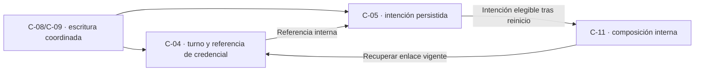

# Design

## Context

C-02 aporta coordinación transaccional por agenda (AW-01 a AW-05). C-03 cubre acceso interno del odontólogo. La KB 03 a 07 fija el comportamiento aprobado, y la KB 08 a 10 identifica PT-04, PB-07 y AT-04 como pendientes de diseño para enlaces.

## Goals / Non-Goals

**Goals:** definir el contrato entre emisión, validación, revocación y composición posterior de un enlace, y su integración con avisos persistidos.

**Non-Goals:** implementación, esquema físico, experiencia visual y envío de correo. C-09/C-14 consumen el contrato de autogestión y C-11 compone los mensajes.

Decision: no (no UI)

## Decisions

### Contrato propuesto entre C-04 y C-05

La contraparte de este contrato está en el [diseño de C-05](../2026-11-23-intenciones-notificacion/design.md#contrato-propuesto).

| Operación | Entrada y resultado |
|---|---|
| Emitir | Recibe el turno en una escritura coordinada y devuelve una referencia interna de credencial. La creación del turno, credencial e intención aplicable comparten confirmación. |
| Validar | Recibe la credencial presentada, comprueba su alcance y estado y devuelve la autorización limitada al turno o una denegación. Las escrituras vuelven a comprobar la autorización y el estado vigente dentro de la coordinación de agenda. |
| Invalidar | Recibe la referencia y el evento aplicable según PB-07. Su efecto persistido se coordina con el cambio de turno o la recuperación que lo origina. |
| Componer | Recibe una intención elegible con turno, revisión, destinatario previsto y referencia. Comprueba correspondencia y vigencia. Devuelve un enlace únicamente a la composición interna o un motivo operativo sin incluir material privado. Una referencia perdida o inaccesible no genera otra credencial por omisión. |

**Recomendación para AT-04, pendiente de revisión.** Credencial opaca impredecible con un verificador para la validación y material recuperable protegido para la composición. Mantener una referencia a la versión del material y a la clave requerida. Mantener la clave separada de PostgreSQL y disponible tras reinicio según política local revisada. C-05 retiene solo la referencia. La disponibilidad de una clave antigua, la rotación, el descarte y la actuación ante pérdida de clave requieren revisión CRITICAL. Un verificador aislado no permite componer el enlace. Como alternativas, evaluar una derivación determinística con clave separada, que aumenta el impacto de una clave comprometida, o emitir la credencial al componer, que cambia la semántica de rotación, consistencia y recuperación.

**Recomendación para PB-07, pendiente de decisión.** Mostrar solo fecha, hora, motivo si se aprueba y acciones aplicables. Evaluar conservar la credencial al reprogramar versus rotarla y sustituir referencias pendientes. Para cancelación, elegir entre revocar todo acceso o permitir consulta limitada del estado cancelado durante un lapso aprobado. Separar la vigencia para consultar de los plazos para escribir. Ante pérdida o correo incorrecto, evaluar recuperación asistida con verificación y revocación coordinada versus derivar al contacto hasta aprobar el flujo. La reserva sigue disponible sin cuenta ni verificación previa de email.

**Transporte pendiente.** Evaluar separar el secreto de la navegación inicial con una entrega al backend desde el cliente, frente a llevarlo en la URL y gestionar su exposición en logs, historial y referencias. Revisar protección de datos, URL base local del contrato vigente, previsualización y manejo en C-14 antes de elegir el transporte. No se fija formato de token, duración, mecanismo de navegador ni cantidad de enlaces activos.

## Diseño v1.1 aprobado

Esta versión fija la recomendación entre las alternativas anteriores. La consulta vence al fin previsto del turno, excluido ese instante. Muestra fecha, hora, estado y acciones disponibles. La reserva y las escrituras de autogestión admiten exactamente 24 horas y se evalúan contra el estado vigente bajo coordinación de agenda. El extremo de reserva de 30 días calendario se incluye a la misma hora local del consultorio. Reprogramar conserva la credencial y actualiza su vencimiento. La consulta carga el estado vigente del turno. Cancelar revoca la credencial en la misma confirmación, por lo que un enlace anterior muestra una respuesta genérica de enlace no disponible, sin revelar datos del turno ni permitir acciones.

El secreto es opaco, de 32 bytes aleatorios. C-04 conserva un verificador SHA-256 y material cifrado con AES-256-GCM, nonce nuevo y versión de clave. Las claves quedan fuera del repositorio y de PostgreSQL. Una rotación usa la clave nueva para las emisiones siguientes y conserva las anteriores mientras exista material vigente que las necesite. Una clave ausente impide componer enlaces afectados. La validación de enlaces vigentes sigue disponible mediante el verificador. Un compromiso confirmado exige revocar los enlaces afectados y recuperar acceso por el flujo asistido. C-14 recibe el secreto en el fragmento de la URL y lo elimina con history.replaceState. Lo mantiene en memoria y lo transmite al backend en un encabezado excluido de los logs.

### Operación interna de recuperación asistida

C-04 propone una operación autenticada del odontólogo por turno, conceptualmente `POST /api/odontologo/turnos/{id}/recuperacion-enlace`. Recibe el motivo, el método de verificación confirmado y el campo obligatorio `emailConfirmado` con la dirección exacta que el odontólogo confirmó, incluso cuando conserva la anterior. El odontólogo verifica presencialmente el documento o devuelve la llamada a un número previamente verificado por el consultorio. Sin evidencia suficiente, se requiere atención presencial. Se registra quién realizó la operación, cuándo y qué método usó, sin copiar el documento ni registrar el secreto.

Bajo coordinación de agenda, la operación comprueba que el turno siga confirmado y dentro de su vigencia de consulta, revoca las credenciales anteriores, emite una nueva y coordina con C-05 el tratamiento de los avisos relacionados. Prepara la entrega al destinatario confirmado mediante una intención explícita de recuperación. La respuesta interna devuelve el resultado y la referencia operativa, sin devolver el enlace. C-04 cubre el endpoint y el ciclo de credenciales. C-05 cubre la intención durable y C-11 realiza el envío. Un turno cancelado o vencido no se reactiva por recuperar acceso.

### Recordatorio durante la recuperación

En la misma transacción de recuperación, C-05 vuelve a leer el despacho bajo coordinación de agenda. Un recordatorio pendiente, vigente y sin autorización ni historial de intentos conserva su identidad, revisión y programación. Solo se cambia la referencia de credencial y, si corresponde, el destinatario confirmado expresamente por el odontólogo. La edición por sí sola de un paciente no ejecuta esta operación. Si falla cualquiera de las escrituras, se conservan la credencial anterior y los avisos previos.

Un aviso autorizado, en curso o con resultado incierto conserva el destinatario y la referencia originales, junto con su historial. El tratamiento del intento y la exclusión de nuevos intentos se definen en [C-05](../2026-11-23-intenciones-notificacion/design.md#recordatorio-durante-la-recuperación).

## Risks / Trade-offs

- Pérdida de clave → reportar imposibilidad de composición, conservar evidencia operativa sin secretos y aplicar la política acordada.
- Email incorrecto o enlace reenviado → limitar alcance, datos visibles y vigencia. Revisar recuperación y corrección junto a C-05.
- Credencial revocada durante composición → C-05/C-11 coordinan el punto de inicio del envío. La invalidación sigue aplicando al intentar usar el enlace.

## Casos pendientes de decisión

| Caso | Preparación | Resultado que se debe acordar |
|---|---|---|
| CA-04-P1 · PB-07 | Consultar antes, exactamente en y después del vencimiento de la credencial. | Vigencia para consulta y lista de datos permitidos. |
| CA-04-P2 · PB-07 | Reprogramar o cancelar con un enlace emitido y avisos pendientes. | Qué enlaces sobreviven, qué referencias se revocan y qué puede consultar el paciente. |
| CA-04-P3 · PB-07 / AT-04 | Simular pérdida, destinatario incorrecto y ausencia de clave tras reinicio. | Quién puede recuperar, qué evidencia se exige y si corresponde emitir una credencial nueva mediante recuperación explícita. |
| CA-04-P4 · PB-01 | Con credencial vigente, intentar cancelar o reprogramar antes, exactamente en y después del plazo de autogestión de 24 horas. | Inclusión del instante límite y momento en que se evalúa el plazo. PB-09 trata los avisos de una reserva admitida en ese borde. |

## Aprobaciones

Las [tareas 1.1 y 1.2](tasks.md) registran la aprobación explícita de Ignacio para el diseño v1.1 y la implementación CRITICAL de C-04, incluida la recuperación asistida. La [revisión independiente](revision-independiente.md) documenta la evidencia del árbol que evaluó. C-14 requiere su propia revisión para incorporar el transporte en navegador.
