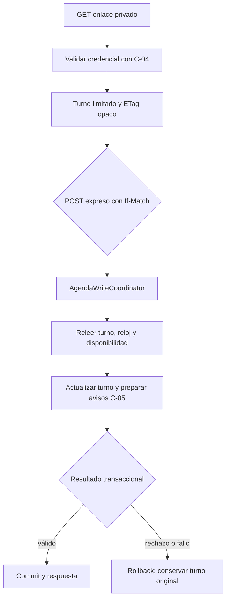

# Design

## Context

La base integrada ya coordina escrituras por agenda con una transacción raíz, bloqueo de la agenda y relectura de datos después del bloqueo (`AgendaWriteCoordinator#write`). C-04 valida y revoca credenciales de autogestión; C-05 prepara intenciones persistentes dentro de la transacción (`CredencialesGestion#validar`, `PreparacionAvisos#cambio`). C-06/C-07 proveen reglas de disponibilidad, y C-08 consume estas capacidades para confirmar reservas. La motivación y los límites de producto están en `proposal.md`; el comportamiento observable, en `specs/appointment-self-management/spec.md`.

## Goals / Non-Goals

**Goals:**

- Aplicar las reglas temporales y de disponibilidad con datos releídos bajo la coordinación de agenda.
- Mantener juntos el resultado del turno, la revisión, la credencial cuando corresponda y las intenciones de cambio.
- Exponer errores HTTP estables y acotados sin información interna ni datos del paciente.
- Pasar internamente a C-09 la referencia opaca que C-05 necesita para vincular avisos al enlace vigente, sin exponer el secreto.

**Non-Goals:**

- Cambiar las políticas de C-04: emisión, reglas de validación, expiración, transporte o recuperación asistida de credenciales. Se permite únicamente ampliar el resultado interno de `validar` con el UUID opaco de la credencial vigente.
- Cambiar C-05, enviar correo desde C-09, crear migraciones o agregar idempotencia de cliente.
- Crear operaciones manuales del odontólogo o definir un canal concreto de contacto fuera del plazo.
- Implementar interfaz de usuario.

## Decisions

### D-01 — Reutilizar las capacidades aprobadas de C-04/C-05

Validar el enlace mediante C-04 y preparar avisos mediante C-05. No se leen ni exponen secretos de credencial desde C-09. La cancelación revoca la credencial en la misma operación; la reprogramación conserva la credencial vigente según EN-02 de C-04. **Alternativa descartada:** duplicar en C-09 la lógica de validación, emisión, recuperación o composición del enlace, porque divergiría del contrato de credenciales ya aprobado.

### D-02 — Coordinar y releer antes de decidir

Ejecutar cada cancelación o reprogramación dentro de `AgendaWriteCoordinator#write`. Dentro de la coordinación, releer turno, revisión, instante actual, configuración y ocupación; validar el ETag, el plazo inclusivo de 24 horas y, para reprogramar, el nuevo inicio y su duración actualmente configurada (PB-05). Confirmar la escritura del turno y las intenciones de `PreparacionAvisos#cambio` en la misma transacción. **Alternativa descartada:** validar el horario o el estado antes de esperar por la agenda, porque una lectura previa puede quedar obsoleta.

### D-03 — Usar ETag opaco e `If-Match` para las escrituras

La consulta devuelve el ETag opaco de la revisión actual y no copia la revisión numérica al cuerpo. Cancelación y reprogramación exigen ese ETag en `If-Match`; la ausencia de precondición responde `428 PRECONDITION_REQUIRED` y una revisión desactualizada responde `412 TURN_VERSION_MISMATCH`. **Alternativas descartadas:** aceptar escrituras sin precondición, que habilitaría sobrescribir cambios concurrentes, o agregar una clave de idempotencia de cliente, que no forma parte del alcance acordado.

### D-04 — Mantener la respuesta pública mínima y uniforme

Las respuestas de error usan `{ "codigo": "..." }`, siguiendo el patrón de las APIs existentes (`AvailabilityErrorAdvice`). Una credencial no disponible se presenta como `404 LINK_NOT_AVAILABLE`; el plazo de autogestión cerrado como `409 MANAGEMENT_WINDOW_CLOSED`; un destino inválido u ocupado como `409 SLOT_UNAVAILABLE`; la espera agotada como `409 AGENDA_BUSY`; una precondición desactualizada como `412 TURN_VERSION_MISMATCH`; y una precondición ausente como `428 PRECONDITION_REQUIRED`. Los fallos técnicos se responden sin detalles internos. **Alternativa descartada:** exponer excepciones de C-04, datos de paciente o causas que permitan distinguir credenciales inválidas, revocadas y vencidas.

### D-05 — Preparar avisos sin enviar correo en la operación

Tras el cambio, C-05 registra la intención `CAMBIO`, invalida recordatorios anteriores elegibles y programa el recordatorio correspondiente a la nueva revisión cuando aplica. La respuesta refleja `PENDIENTE`; no se llama SMTP ni se interpreta el resultado del emisor como rollback del turno. **Alternativa descartada:** retener el bloqueo de agenda mientras se realiza una llamada externa.

### D-06 — Recibir la credencial privada en un encabezado dedicado

Los tres endpoints reciben el secreto mediante `X-Management-Token`, según el contrato aprobado de C-04 de eliminarlo del fragmento de navegación y transmitirlo en un encabezado excluido de logs. No se acepta en URL ni cuerpo y no se registra su valor. Las respuestas de la API llevan `Cache-Control: no-store`. `/api/gestion/**` conserva su autorización propia y no se agrega a la cadena de sesión del odontólogo.

### D-07 — Exponer solo la referencia opaca al consumidor interno

`CredencialesGestion.validar` incluirá en `TurnoAutorizado` el UUID de la fila de credencial vigente, además de los datos actuales del turno. C-09 lo pasará a `PreparacionAvisos.cambio` para asociar el evento y el recordatorio de reprogramación al enlace que sigue vigente. El UUID no es el secreto bearer ni permite reconstruirlo; el secreto no sale del flujo actual de validación. C-09 no consultará directamente las tablas de C-04. **Alternativas descartadas:** leer la referencia con SQL desde C-09, que acopla la API al esquema privado de C-04, o registrar avisos de reprogramación sin el enlace vigente, que incumple C-05.

**Aprobación de gobernanza:** Santiago autorizó explícitamente esta extensión CRITICAL el 2026-11-25. La autorización cubre solo el UUID opaco en el resultado interno de validación; cualquier cambio adicional de política o mecanismo de credenciales queda fuera de alcance.

### D-08 — Vincular el ETag opaco al turno, revisión y respuesta

Generar el `ETag` como un digest SHA-256 en Base64 URL sin padding, entre comillas, a partir de una codificación canónica versionada de la identidad interna del turno, su revisión y todos los campos de consulta devueltos (fecha, horas, estado y acciones). El encabezado no revela el UUID ni la revisión. Incluir las acciones hace que el validador también cambie cuando el plazo de autogestión modifica la consulta aunque el turno no haya sido escrito. El `ETag` devuelto por reprogramación identifica la consulta GET posterior y puede usarse en su siguiente `If-Match`; el cuerpo POST también devuelve el ID del turno autorizado y el estado de notificación. **Alternativas descartadas:** incluir la revisión numérica en el encabezado o calcular el tag solo desde ella, porque la primera la expone y la segunda no refleja cambios temporales en las acciones disponibles.

## Risks / Trade-offs

- [Riesgo] La consulta GET puede ser previsualizada por navegadores o escáneres → no ejecuta escrituras; las dos mutaciones requieren POST expreso y `If-Match`.
- [Riesgo] Una reprogramación puede competir con otra escritura de agenda → releer bajo coordinación, usar restricciones de PostgreSQL y revertir conjuntamente turno y avisos ante conflicto.
- [Riesgo] El destinatario puede no recibir el correo aunque el turno haya cambiado → confirmar el cambio con la intención `PENDIENTE` y dejar el resultado de comunicación al flujo C-11.
- [Trade-off] La decisión 3B no devuelve éxito repetido tras cancelación → prioriza no revelar estado a través de una credencial revocada y evita avisos duplicados.
- [Riesgo] Las pruebas de integración dependen de PostgreSQL real y del soporte de archivos seguro de C-04 → verificar en un entorno Linux con JDK 21; no debilitar C-04 para adaptar la prueba a Windows.

## Migration Plan

No se prevén migraciones ni cambios de configuración. El despliegue puede revertirse retirando la API C-09; la transacción garantiza que cada escritura confirmada conserva el nuevo estado y que las fallidas no dejan cambios parciales.

## Resoluciones de producto

- **PB-01:** Santiago confirmó para C-09 el límite inferior inclusivo de 24 horas, medido con el `Clock` del backend bajo coordinación de agenda. El destino de reprogramación también cumple la ventana de C-07: fecha local hasta `fechaLocal(ahora) + 30 días`, inclusive, en `America/Argentina/Mendoza`.
- **PB-06:** C-09 no agrega altas ni operaciones manuales del odontólogo ni define un canal de contacto fuera del plazo.
- **PB-07:** C-04 conserva el contrato de credencial: consulta con fecha, hora, estado y acciones, sin datos de contacto; reprogramar mantiene el enlace hasta el nuevo fin exclusivo; cancelar revoca el enlace y las consultas posteriores responden de forma genérica.
- **PB-08:** Santiago aprobó la opción 3B: la primera cancelación confirmada devuelve `CANCELADO`; usar el enlace revocado después responde `404 LINK_NOT_AVAILABLE`, sin datos ni una segunda intención de aviso. Una escritura con revisión obsoleta responde `412 TURN_VERSION_MISMATCH`; no se agrega reactivación ni clave de idempotencia.
- **PB-10/PB-11:** C-09 prepara las intenciones según C-05, informa `PENDIENTE` y no envía SMTP. La elegibilidad de avisos anteriores y de la revisión vigente queda a cargo del contrato aprobado de C-05.

## UI Mockups

- Decision: no (no UI)

## Flujo de escritura coordinada

